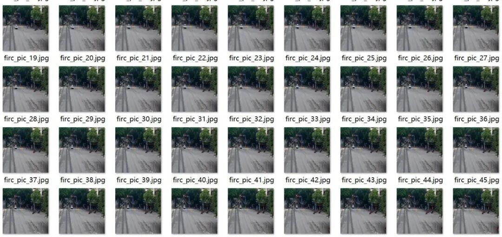
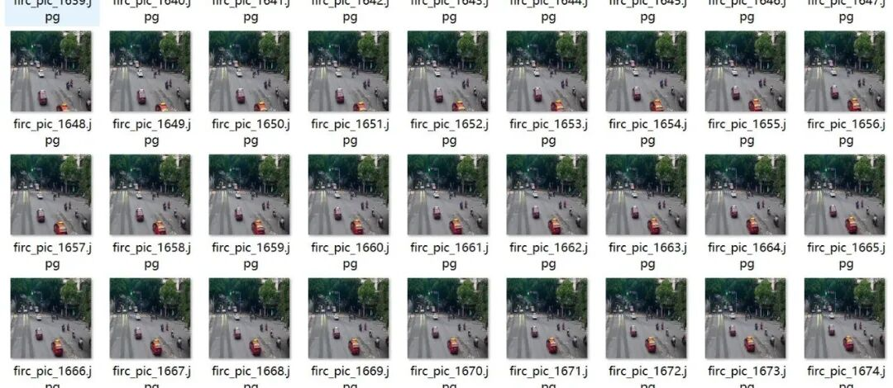
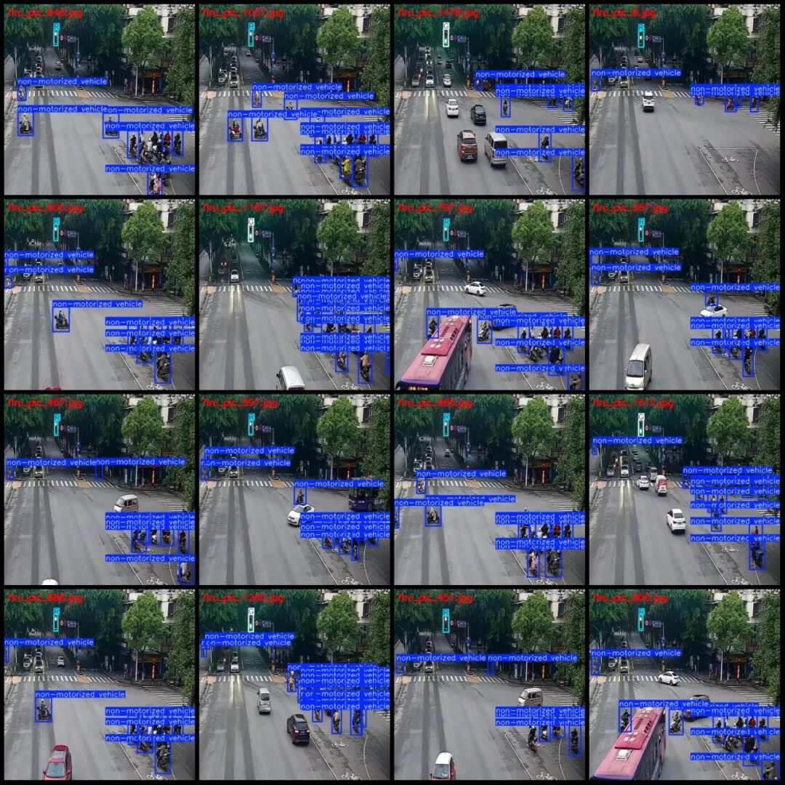
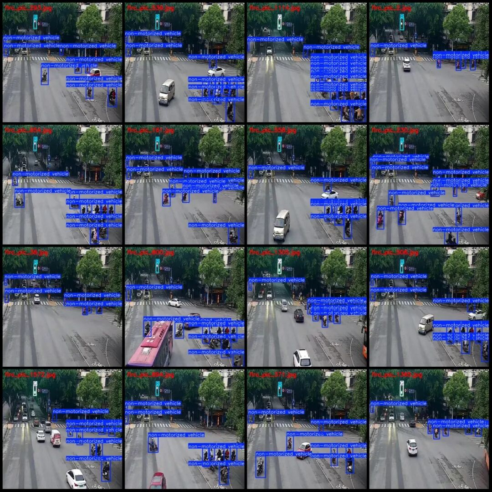

# Dataset for Non-motorized Vehicles and E-Mopeds Crossing Red Lights in VOC+YOLO format with 1754 images across 3 categories

Please note that the images in the dataset are formed by extracting frames from videos, which may appear to be repeated (in reality, there are no repeated images). Please pay attention to the image previews.

Dataset format: Pascal VOC format + YOLO format (txt file without split path, only containing jpg images and corresponding VOC format xml files and yolo format txt files)

Number of images (number of jpg files): 1754

Number of annotations (number of xml files): 1754

Number of annotations (number of txt files): 1754

Label category count: 3

Label category names (note that the order of yolo format categories does not correspond to this, but is based on the labels folder's classes.txt): ["G", "R", "non-motorized vehicle"]

Number of boxes labeled in each category:

G (Green Light) Frames = 707

R (red light) frame count = 1047

Non-motorized vehicle (non-motorized vehicle) Frame count = 16646

Total frame count: 18400

Number of images per category:

G (Green Light) occupancy = 707

R (Red Light) occupancy count = 1047

Non-motorized vehicle (non-motorized vehicle) ownership count = 1754

Image resolution: 512x512

Using labelImg:

Annotation rules: Draw a rectangle around the category.

Important Notice: The dataset does not have separate training, validation, and test sets; you need to partition them yourself.

Special : This dataset does not guarantee the accuracy of the trained models or weight files.

Image Preview:

Annotation example:

## Payment

Here is a pay link on Stripe ( https://buy.stripe.com/3cs8yP7sY87d0vu9AB ). Please contact me lonlonago@foxmail.com after funding $89, and I will send you a complete data files , thank you!

